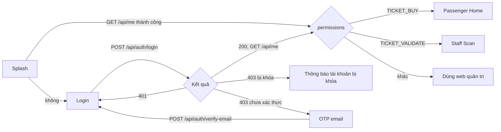
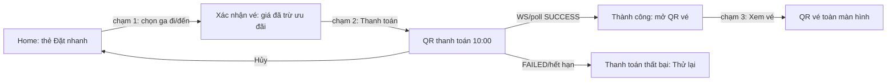
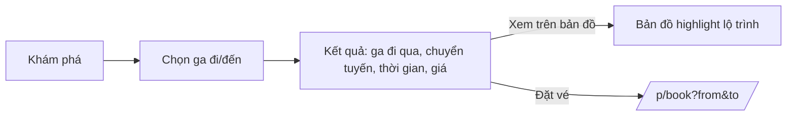
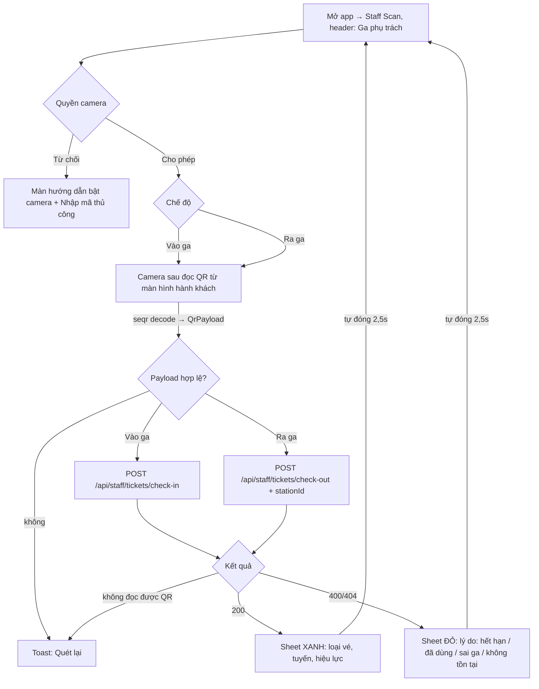
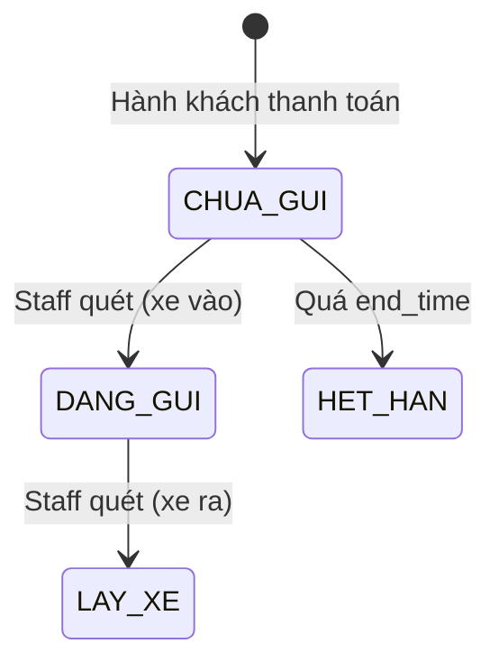

# Metro Mobile App: Đề cương thiết kế UI & Prototype (Flutter)

> **Phạm vi:** App di động cho **Hành khách (Passenger)** và **Nhân viên soát vé (Staff Station)** của hệ thống "Đặt vé Metro tích hợp Chatbot".
> **Trạng thái:** Bản thiết kế, flow và prompt triển khai. **Chưa có code thật.**
> **Nguồn yêu cầu:** Báo cáo Đồ án 1 (mục 1.4.2, 3.1, 3.2.3, 3.3) và UI web quản trị trong repo `metro_web_UI`.
> **Ngày lập:** 24/10/2026 · **Cập nhật:** chốt Leaflet, một codebase phân quyền theo vai trò, `seqr` cho QR, soát vé bằng camera, quy tắc chia nhỏ component (mục 13.1)

---

## Mục lục

1. [Mục tiêu & nguyên tắc](#1-mục-tiêu--nguyên-tắc)
2. [Bản đồ yêu cầu → màn hình](#2-bản-đồ-yêu-cầu--màn-hình)
3. [Đồng nhất UI với website (Design tokens)](#3-đồng-nhất-ui-với-website-design-tokens)
4. [Kiến trúc Flutter & cấu trúc thư mục](#4-kiến-trúc-flutter--cấu-trúc-thư-mục)
5. [Thư viện component (Design System)](#5-thư-viện-component-design-system)
6. [Điều hướng & phân quyền](#6-điều-hướng--phân-quyền)
7. [User flow](#7-user-flow)
8. [Prototype từng màn hình (wireframe)](#8-prototype-từng-màn-hình-wireframe)
9. [Hợp đồng API & realtime](#9-hợp-đồng-api--realtime)
10. [Trạng thái, lỗi & phi chức năng](#10-trạng-thái-lỗi--phi-chức-năng)
11. [Prompt triển khai chi tiết](#11-prompt-triển-khai-chi-tiết)
12. [Lộ trình thực hiện & Definition of Done](#12-lộ-trình-thực-hiện--definition-of-done)
13. [Quyết định đã chốt & vấn đề còn mở](#13-quyết-định-đã-chốt--vấn-đề-còn-mở)

---

## 1. Mục tiêu & nguyên tắc

| # | Nguyên tắc | Cách áp dụng |
|---|---|---|
| P1 | **Một codebase, phân quyền theo vai trò khi đăng nhập** | Một app Flutter, một bản build, một màn đăng nhập chung. Sau đăng nhập, backend trả `role` và app nạp **Passenger Shell** hoặc **Staff Shell**. Hai shell không lẫn màn hình của nhau. Không tách app hay flavor riêng cho từng vai trò. |
| P2 | **Đồng nhất với web** | Dùng chung bảng màu, font *Be Vietnam Pro*, bo góc 12px, nhãn trạng thái, định dạng tiền `12.000 ₫`, màu tuyến, tên ga và thuật ngữ tiếng Việt. Xem mục 3. |
| P3 | **≤ 3–4 chạm cho nghiệp vụ chính** | Theo khảo sát (mục 1.2.2): đặt vé lượt **3 chạm** từ Trang chủ (Chọn ga đi/đến → Thanh toán → Xác nhận). Mở QR vé **1 chạm**. |
| P4 | **Phản hồi ≤ 2s** | Skeleton thay spinner. Cache danh mục (ga, tuyến, loại vé). Gọi lạc quan (optimistic) cho thao tác nhẹ. |
| P5 | **An toàn dữ liệu** | Token lưu trong `flutter_secure_storage`. QR chỉ chứa token vé/lượt gửi xe, không chứa thông tin cá nhân. Không lưu vị trí khi chưa có đồng ý. |
| P6 | **Feature-first Clean Architecture, component nhỏ** | Mỗi tính năng có 3 lớp `data / domain / presentation`. Component dùng chung nằm ở `design_system`. **Mỗi widget một file**, màn hình chỉ ghép các section con. Không dồn nhiều widget vào một file lớn (quy tắc chi tiết ở mục 4.3). |

**Không thuộc phạm vi:** tích hợp phần cứng cổng soát vé, GPS thật trên tàu (vị trí tàu được mô phỏng qua WebSocket), nghiệp vụ kế toán (đã có trên web).
**Không được sử dụng icon hệ thống** 
**Dựa vào các nguyên tắc UI để thực hiện coding**

---

## 2. Bản đồ yêu cầu → màn hình

### 2.1 Hành khách

| Use case (báo cáo) | Màn hình / thành phần | Mã màn |
|---|---|---|
| UC1-01 Đăng nhập (email chưa xác thực thì qua OTP) | Login → OTP | A1, A3 |
| UC1-02 Đăng ký + OTP, gửi lại OTP | Register → OTP | A2, A3 |
| UC1-03 Quên/Đổi mật khẩu | Forgot → OTP → Đặt mật khẩu mới | A4 |
| UC1-04 Đăng xuất | Tài khoản → Đăng xuất | P50 |
| UC2-01 Xem/cập nhật thông tin cá nhân | Hồ sơ | P51 |
| UC4-02 Xem thông tin ga & tuyến | Danh sách tuyến, chi tiết tuyến, chi tiết ga | P20, P21, P22 |
| UC5-01 / UC6-01 Sơ đồ tuyến | Bản đồ mạng lưới (lọc theo tuyến) | P23 |
| UC5-02 Tìm ga gần nhất | Sheet "Ga gần bạn" trên bản đồ | P24 |
| UC5-03 Tra cứu lộ trình giữa hai ga | Tra cứu lộ trình → Kết quả | P25, P26 |
| UC6 Tiện ích & xe buýt quanh ga | Tab "Quanh ga" trong chi tiết ga | P22 |
| Theo dõi vị trí tàu (WebSocket) | Lớp "Tàu đang chạy" trên bản đồ, ETA trong chi tiết ga | P23 |
| UC7 Loại vé & giá vé | Bảng giá (chỉ xem) | P34 |
| UC8-01 Đặt vé + thanh toán QR | Chọn vé → Xác nhận → Thanh toán QR → Kết quả | P30–P33 |
| UC8-02 Danh sách vé đã mua | Vé của tôi | P40 |
| UC8-03 Chi tiết vé + mã QR | Chi tiết vé (QR toàn màn hình) | P41 |
| UC9-01 Lịch sử giao dịch cá nhân | Lịch sử giao dịch | P52 |
| UC10-01 Đăng ký gửi xe + thanh toán | Đặt chỗ gửi xe → Thanh toán QR | P35, P32 |
| UC10-02 QR gửi xe | Thẻ gửi xe đang hiệu lực (Trang chủ + Vé của tôi) | P42 |
| UC11-01/02/03 Ưu đãi, tích điểm, hạng | Thành viên & ưu đãi | P53 |
| UC13-01/02 Thông báo theo sự kiện, gợi ý | Hộp thông báo | P60 |
| UC13-03 Tùy chọn thông báo | Cài đặt thông báo | P54 |
| Tin tức Metro (mục 1.4.2.1) | Tin tức & thông báo vận hành | P61 |
| UC14-01/02/03 Chatbot | Trợ lý ảo | P70 |

### 2.2 Nhân viên soát vé

| Use case | Màn hình | Mã màn |
|---|---|---|
| UC1-01, UC1-04 | Login (dùng chung), Đăng xuất | A1, S40 |
| UC12-01 Check-in vé | Quét vé, chế độ **Vào ga** | S10 |
| UC12-02 Check-out vé (chọn ga) | Quét vé, chế độ **Ra ga** | S10 |
| Kết quả hợp lệ / không hợp lệ | Sheet kết quả quét | S11 |
| UC10-03 Lượt gửi xe tại ga phụ trách | Quét QR gửi xe → đổi trạng thái | S20, S21 |
| UC2-03 Ga được phân công (chỉ đọc) | Header ca làm + Hồ sơ | S00, S40 |
| Ghi log người thực hiện | Lịch sử quét trong ca | S30 |

---

## 3. Đồng nhất UI với website (Design tokens)

Nguồn: `src/styles.css` (oklch), đã quy đổi sang hex sRGB để dùng trong Flutter `ThemeData`.

### 3.1 Màu (Light, mặc định cho Passenger)

| Token web | Hex Flutter | Vai trò |
|---|---|---|
| `--background` | `#F3F8FA` | Nền màn hình (`scaffoldBackgroundColor`) |
| `--foreground` | `#0B1C2C` | Chữ chính |
| `--card` | `#FFFFFF` | Card, sheet |
| `--primary` | `#00878F` | Nút chính, tab đang chọn, link |
| `--primary-foreground` | `#FCFCFC` | Chữ trên primary |
| `--secondary` | `#DDEFF5` | Nút phụ, chip |
| `--muted` / `--muted-foreground` | `#E8F0F4` / `#576574` | Nền phụ / chữ phụ |
| `--accent` | `#F3821D` | Nhấn (giờ cao điểm, ưu đãi, hạng) |
| `--destructive` | `#E7000B` | Lỗi, vé không hợp lệ |
| `--success` | `#25984D` | Thành công, vé hợp lệ |
| `--bus` | `#4EA739` | Trạm/tuyến xe buýt |
| `--border` | `#D5E0E6` | Viền, divider |

### 3.2 Màu thương hiệu tối (dùng cho Staff Shell và màn Auth)

Web dùng sidebar xanh navy, nên app soát vé dùng cùng bảng màu này (tương phản cao khi quét QR ngoài trời).

| Token web | Hex |
|---|---|
| `--sidebar` | `#06192C` |
| `--sidebar-foreground` | `#CBDAE2` |
| `--sidebar-primary` | `#00BEC7` |
| `--sidebar-accent` | `#142A41` |

**Dark mode (Passenger):** nền `#020618`, card `#0F172B`, chữ `#F8FAFC`, muted `#1D293D` / `#90A1B9`, destructive `#FF6467`. Giống `.dark` trên web.

### 3.3 Màu tuyến (dùng chung dữ liệu `MetroLine.colorHex`)

| Tuyến | Màu | Trạng thái |
|---|---|---|
| Tuyến 1 Bến Thành – Suối Tiên | `#E2231A` | Đang khai thác |
| Tuyến 2 Bến Thành – Tham Lương | `#F7A800` | Quy hoạch (nét đứt) |

> Màu tuyến **luôn đọc từ API** (`metro_line.color_hex`), không hard-code trong widget.

### 3.4 Typography, bo góc, khoảng cách

| Thuộc tính | Giá trị | Ghi chú |
|---|---|---|
| Font | **Be Vietnam Pro** (`google_fonts` hoặc bundle asset) | Giống web |
| Scale | `display 28/700`, `title 20/600`, `titleSmall 16/600`, `body 14/400`, `label 12/500`, `stat 24/700` | `stat` ứng với `StatCard` trên web (text-2xl bold) |
| Bo góc | `radius = 12` (lg), `sm = 8`, `md = 10`, `xl = 16`, `2xl = 20` | Theo `--radius: 0.75rem` |
| Khoảng cách | Lưới 4pt: `4 / 8 / 12 / 16 / 24 / 32` | Lề màn hình 16 |
| Icon | `lucide_icons` (cùng bộ icon với web) | VD: `TrainFront`, `Ticket`, `Bus`, `MapPin` |
| Vùng chạm | ≥ 48×48 | Theo Material |

### 3.5 Bảng trạng thái chung (map 1-1 với `StatusBadge` trên web)

| Mã | Nhãn | Nền / chữ |
|---|---|---|
| `ACTIVE` | Hoạt động | success 15% / success |
| `INACTIVE` | Ngừng | muted / mutedFg |
| `PENDING` / `PENDING_PAYMENT` | Chờ thanh toán | accent 20% / accentFg |
| `PAID` | Chưa sử dụng | primary 15% / primary |
| `IN_USE` | Đang sử dụng | accent 20% / accentFg |
| `USED` | Đã sử dụng | muted / mutedFg |
| `EXPIRED` | Hết hạn | muted / mutedFg |
| `CANCELLED` | Đã hủy | destructive 15% / destructive |
| `REFUNDED` | Hoàn tiền | primary 15% / primary |
| `SUCCESS` / `FAILED` | Thành công / Thất bại | success / destructive |
| Gửi xe `CHUA_GUI → DANG_GUI → LAY_XE` | Chưa gửi / Đang gửi / Đã lấy xe | secondary / accent / muted |

> Mã trạng thái lấy theo CHECK constraint của các bảng `ticket`, `orders`, `payment`, `parking_booking` (mục 3.3.2).

### 3.6 Định dạng dùng chung

- Tiền: `NumberFormat.decimalPattern('vi_VN')` + `" ₫"`, giống hàm `money()` của web.
- Ngày giờ: `dd/MM/yyyy HH:mm`, múi giờ `Asia/Ho_Chi_Minh`.
- Số lượt: `12.345` (phân tách hàng nghìn bằng dấu chấm).

---

## 4. Kiến trúc Flutter & cấu trúc thư mục

### 4.1 Tech stack đề xuất

| Lớp | Thư viện | Lý do |
|---|---|---|
| Ngôn ngữ / SDK | Dart 3, Flutter stable | Null-safety, records, pattern matching |
| State management | **flutter_riverpod** + `riverpod_generator` | Dễ test, không phụ thuộc `BuildContext`, `AsyncValue` sẵn ba trạng thái loading/error/data |
| Điều hướng | **go_router** (`StatefulShellRoute` cho bottom nav) | Deep link, guard theo vai trò |
| Mạng | **dio** + interceptor (JWT, refresh, retry) | Khớp REST Spring Boot |
| Model | **freezed** + `json_serializable` | Immutable, `copyWith`, union type cho state |
| Realtime | `stomp_dart_client` (WebSocket `/ws`) | Spring hỗ trợ STOMP sẵn, dùng để broadcast vị trí tàu và thông báo |
| Lưu trữ | `flutter_secure_storage` (token), `shared_preferences` (cài đặt), `drift`/`isar` (cache danh mục, tùy chọn) | |
| QR | **`seqr`** (tạo và giải mã nội dung QR), `mobile_scanner` (lấy khung hình từ camera để nhân viên quét) | Đã chốt. Bọc sau interface `QrCodec` trong `core/qr/`, feature không gọi thẳng thư viện. Xem mục 13 |
| Bản đồ | **`flutter_map`** (bản Leaflet cho Flutter) + tile OpenStreetMap | Đã chốt Leaflet để đồng nhất với web (`LineMapPreview` dùng Leaflet/OSM), không tốn phí API key. Không dùng Google Maps |
| Định vị | `geolocator` | UC5-02 |
| Push | `firebase_messaging` + bảng `device_token` | UC13-01 |
| i18n | `flutter_localizations` + `intl` (`vi` mặc định, `en`) | Song ngữ như HURC |
| Kiểm thử | `flutter_test`, `mocktail`, `golden_toolkit`, `integration_test` | |

### 4.2 Cấu trúc thư mục (feature-first + Clean Architecture)

Một codebase, một entry point `main.dart` cho cả hai vai trò. Flavor `dev/staging/prod` chỉ dùng để đổi môi trường (BASE_URL), **không** dùng để tách vai trò.

```text
metro_mobile/
├─ lib/
│  ├─ main.dart                              # bootstrap + ProviderScope (chung 2 vai trò)
│  ├─ app/
│  │  ├─ app.dart                            # MaterialApp.router, theme theo role, locale
│  │  ├─ router/
│  │  │  ├─ app_router.dart                  # go_router, ghép các nhóm route
│  │  │  ├─ auth_redirect.dart               # redirect: chưa đăng nhập / sai vai trò
│  │  │  ├─ route_access.dart                # ROUTE_ACCESS (giống web permissions.ts)
│  │  │  ├─ routes.dart                      # hằng số path
│  │  │  ├─ auth_routes.dart                 # /auth/*
│  │  │  ├─ passenger_routes.dart            # /p/*
│  │  │  └─ staff_routes.dart                # /s/*
│  │  └─ shells/
│  │     ├─ passenger_shell.dart             # Scaffold + bottom nav 5 tab
│  │     ├─ passenger_nav_items.dart         # cấu hình 5 tab (giống nav.config.ts)
│  │     ├─ staff_shell.dart                 # Scaffold + bottom nav 4 tab, theme tối
│  │     ├─ staff_nav_items.dart
│  │     └─ unsupported_role_screen.dart     # "Vui lòng dùng trang quản trị web"
│  ├─ core/
│  │  ├─ config/env.dart                     # BASE_URL, WS_URL (flavor dev/staging/prod)
│  │  ├─ network/
│  │  │  ├─ dio_client.dart
│  │  │  ├─ auth_interceptor.dart            # gắn Bearer, refresh token 401
│  │  │  ├─ api_exception.dart               # map 400/401/403/404/409/500 → thông điệp VN
│  │  │  └─ stomp_client.dart
│  │  ├─ qr/                                 # lớp bọc seqr, feature chỉ dùng interface
│  │  │  ├─ qr_codec.dart                    # abstract QrCodec { encode(), decode() }
│  │  │  ├─ seqr_codec.dart                  # impl bằng seqr
│  │  │  ├─ qr_payload.dart                  # QrPayload{kind: TICKET|PARKING, token, issuedAt}
│  │  │  └─ camera_scanner.dart              # bọc mobile_scanner: camera sau → chuỗi thô → QrCodec.decode
│  │  ├─ storage/secure_store.dart
│  │  ├─ error/failure.dart                  # sealed class Failure
│  │  ├─ utils/
│  │  │  ├─ money_formatter.dart             # money()
│  │  │  ├─ date_formatter.dart              # dateTime()
│  │  │  └─ vn_text.dart                     # bỏ dấu tiếng Việt cho tìm kiếm
│  │  └─ permissions/
│  │     ├─ location_consent.dart
│  │     └─ camera_permission.dart           # xin quyền camera cho Staff
│  ├─ design_system/                         # ↔ src/components/ui + shared.tsx trên web
│  │  ├─ tokens/
│  │  │  ├─ colors.dart
│  │  │  ├─ typography.dart
│  │  │  ├─ spacing.dart
│  │  │  └─ radius.dart
│  │  ├─ theme/
│  │  │  ├─ metro_theme.dart                 # light, dark, staff
│  │  │  └─ metro_colors_ext.dart            # ThemeExtension
│  │  ├─ atoms/                              # mỗi component một file (mục 5.1)
│  │  │  ├─ metro_button.dart
│  │  │  ├─ metro_icon_button.dart
│  │  │  ├─ metro_text_field.dart
│  │  │  ├─ password_field.dart
│  │  │  ├─ otp_input.dart
│  │  │  ├─ status_badge.dart
│  │  │  ├─ status_badge_map.dart            # bảng nhãn/màu mục 3.5, tách khỏi widget
│  │  │  ├─ line_chip.dart
│  │  │  ├─ money_text.dart
│  │  │  └─ metro_skeleton.dart
│  │  ├─ molecules/                          # mục 5.2
│  │  │  ├─ section_card.dart
│  │  │  ├─ stat_card.dart
│  │  │  ├─ station_tile.dart
│  │  │  ├─ station_picker/                  # component nhiều phần → thư mục riêng
│  │  │  │  ├─ station_picker_sheet.dart     # ghép các phần bên dưới
│  │  │  │  ├─ station_search_field.dart
│  │  │  │  ├─ station_group_list.dart
│  │  │  │  └─ recent_stations.dart
│  │  │  ├─ route_summary_bar.dart
│  │  │  ├─ ticket_card.dart
│  │  │  ├─ parking_pass_card.dart
│  │  │  ├─ countdown_chip.dart
│  │  │  ├─ empty_state.dart
│  │  │  ├─ error_state.dart
│  │  │  ├─ chat_bubble.dart
│  │  │  └─ notification_tile.dart
│  │  ├─ organisms/                          # mục 5.3
│  │  │  ├─ line_diagram/
│  │  │  │  ├─ line_diagram.dart
│  │  │  │  ├─ line_diagram_painter.dart     # CustomPainter
│  │  │  │  └─ line_diagram_station_row.dart
│  │  │  ├─ metro_map/                       # flutter_map (Leaflet)
│  │  │  │  ├─ metro_map_view.dart           # FlutterMap + ghép các layer
│  │  │  │  ├─ osm_tile_layer.dart
│  │  │  │  ├─ line_polyline_layer.dart
│  │  │  │  ├─ station_marker_layer.dart
│  │  │  │  ├─ bus_stop_layer.dart
│  │  │  │  └─ live_train_layer.dart
│  │  │  ├─ qr_pass/
│  │  │  │  ├─ qr_pass_view.dart             # dùng QrCodec (seqr) để vẽ QR
│  │  │  │  ├─ qr_refresh_timer.dart
│  │  │  │  └─ screen_guard.dart             # độ sáng 100% + FLAG_SECURE
│  │  │  ├─ payment_qr_sheet.dart
│  │  │  ├─ scan/
│  │  │  │  ├─ scan_view.dart                # preview camera + khung quét
│  │  │  │  ├─ scan_frame_overlay.dart
│  │  │  │  ├─ torch_button.dart
│  │  │  │  └─ scan_result_sheet.dart        # xanh/đỏ
│  │  │  └─ metro_bottom_nav.dart
│  │  ├─ gallery/design_system_gallery.dart  # chỉ build ở flavor dev
│  │  └─ design_system.dart                  # barrel export
│  ├─ features/
│  │  ├─ auth/            # dùng chung, quyết định vai trò sau đăng nhập
│  │  ├─ home/
│  │  ├─ network/         # tuyến, ga, bản đồ, lộ trình, ga gần nhất, tiện ích
│  │  ├─ live_trains/     # WebSocket vị trí tàu
│  │  ├─ booking/         # đặt vé + thanh toán
│  │  ├─ parking/         # gửi xe (passenger)
│  │  ├─ wallet/          # vé của tôi, QR, lịch sử giao dịch
│  │  ├─ loyalty/         # điểm, hạng, khuyến mãi
│  │  ├─ notifications/   # hộp thư, tin tức, cài đặt
│  │  ├─ chatbot/
│  │  ├─ profile/         # dùng chung 2 vai trò
│  │  └─ staff/
│  │     ├─ shift/           # ga phụ trách, thống kê ca
│  │     ├─ ticket_control/  # quét camera check-in / check-out
│  │     ├─ parking_control/
│  │     └─ scan_history/
│  └─ l10n/ (app_vi.arb, app_en.arb)
└─ test/ (mirror cấu trúc lib/)
```

Mỗi feature có cùng khuôn sau. Ví dụ `booking`: màn hình chỉ là file ghép, từng khối giao diện tách ra `widgets/`, nhóm theo màn:

```text
features/booking/
├─ data/
│  ├─ dtos/
│  │  ├─ order_preview_dto.dart
│  │  └─ payment_dto.dart
│  ├─ sources/
│  │  ├─ booking_remote_source.dart        # dio
│  │  └─ booking_fake_source.dart          # dữ liệu demo khi BASE_URL rỗng
│  └─ repositories/booking_repository_impl.dart
├─ domain/
│  ├─ entities/
│  │  ├─ order_preview.dart
│  │  ├─ fare.dart
│  │  └─ payment_status.dart
│  ├─ repositories/booking_repository.dart # abstract
│  └─ usecases/
│     ├─ preview_order.dart
│     ├─ create_payment.dart
│     └─ watch_payment_status.dart
└─ presentation/
   ├─ controllers/
   │  ├─ booking_controller.dart           # @riverpod AsyncNotifier
   │  └─ payment_controller.dart
   ├─ screens/
   │  ├─ booking_confirm_screen.dart       # chỉ ghép widget, không chứa layout chi tiết
   │  ├─ payment_qr_screen.dart
   │  └─ payment_result_screen.dart
   └─ widgets/
      ├─ booking_confirm/
      │  ├─ trip_header.dart
      │  ├─ fare_breakdown.dart
      │  ├─ discount_row.dart
      │  ├─ loyalty_points_toggle.dart
      │  └─ pay_button_bar.dart
      └─ payment_result/
         ├─ payment_success_view.dart
         ├─ payment_failed_view.dart
         └─ refund_pending_view.dart
```

Ví dụ `staff/ticket_control` (luồng quét camera của bản demo):

```text
features/staff/ticket_control/
├─ data/
│  ├─ sources/ticket_control_remote_source.dart
│  ├─ sources/ticket_control_fake_source.dart   # demo: kiểm tra token sinh từ app Passenger
│  └─ repositories/ticket_control_repository_impl.dart
├─ domain/
│  ├─ entities/scan_result.dart                 # sealed: Valid | Invalid(reason)
│  ├─ entities/scan_mode.dart                   # ENTRY | EXIT
│  └─ usecases/
│     ├─ check_in_ticket.dart
│     ├─ check_out_ticket.dart
│     └─ dedupe_scan.dart                       # chống quét trùng 3s
└─ presentation/
   ├─ controllers/ticket_scan_controller.dart
   ├─ screens/ticket_scan_screen.dart           # ghép header + mode + scan view + stats
   └─ widgets/
      ├─ shift_header.dart
      ├─ scan_mode_switch.dart
      ├─ today_stats_strip.dart
      ├─ manual_code_button.dart
      └─ manual_code_sheet.dart
```

**Quy tắc phụ thuộc:** `presentation → domain ← data`. Widget không gọi `dio` trực tiếp. `design_system` không import `features/`. Feature không import `seqr` hay `mobile_scanner` trực tiếp, chỉ dùng `core/qr/`.

### 4.3 Quy tắc chia nhỏ component

| Quy tắc | Ngưỡng / cách làm |
|---|---|
| Một widget public một file | Tên file `snake_case.dart` trùng tên class. Widget private (`_Xxx`) chỉ được phép nếu ≤ 30 dòng và chỉ dùng trong file đó |
| Giới hạn độ dài | File widget ≤ **150 dòng**, file screen ≤ **100 dòng**, hàm `build()` ≤ **60 dòng**. Vượt thì tách section ra `widgets/` |
| Screen chỉ ghép | `screens/` chỉ chứa `Scaffold`, đọc controller và ghép các section. Không chứa layout chi tiết hay logic |
| Không dùng hàm trả widget | Không viết `Widget _buildHeader()`. Tách thành class `XxxHeader` để Flutter tối ưu rebuild và dễ test |
| Component nhiều phần thì thành thư mục | VD `station_picker/`, `metro_map/`, `scan/`: một file ghép + các file phần con |
| Widget dùng ≥ 2 feature | Chuyển lên `design_system/`. Chỉ dùng trong 1 feature thì để ở `features/<x>/presentation/widgets/` |
| Hằng số & bảng map tách riêng | VD `status_badge_map.dart`, `passenger_nav_items.dart`, `<feature>_constants.dart`, giống `*.constants.ts` trên web |
| Kiểm tra tự động | Bật lint `lines_longer_than_80_chars`, thêm script CI cảnh báo file > 150 dòng trong `lib/**/presentation` và `lib/design_system` |

### 4.4 Bảng đối chiếu kiến trúc web ↔ mobile

| Web (`metro_web_UI`) | Mobile (Flutter) |
|---|---|
| `src/pages/<feature>/` (Page, hooks, service, types, constants) | `features/<feature>/` (screens, controllers, usecases, entities, constants) |
| `hooks/useXxx.ts` | `controllers/xxx_controller.dart` (Riverpod) |
| `xxx.service.ts` (hàm thuần, có test) | `domain/usecases/` + `data/repositories/` |
| `src/components/ui`, `shared.tsx` | `design_system/` |
| `lib/auth/permissions.ts` (`ROUTE_ACCESS`) | `app/router/route_access.dart` |
| `createStore` (mock) | `Provider` + repository giả (`FakeXxxRepository`) cho giai đoạn chưa có backend |

---

## 5. Thư viện component (Design System)

Đặt tên tiền tố `Metro` để không trùng Material. Cột "Web tương ứng" bảo đảm hai nền tảng cùng ngữ nghĩa.

### 5.1 Atoms

| Component | Props chính | Web tương ứng |
|---|---|---|
| `MetroButton` | `variant: primary/secondary/outline/ghost/destructive`, `size: sm/md/lg`, `loading`, `icon`, `expand` | `ui/button.tsx` |
| `MetroIconButton` | `icon`, `tooltip`, `badgeCount` | `Button size="icon"` |
| `MetroTextField` | `label`, `hint`, `error`, `prefixIcon`, `keyboardType` | `ui/input.tsx` |
| `PasswordField` | hiện/ẩn mật khẩu, thanh đo độ mạnh | `login/components/PasswordField.tsx` |
| `OtpInput` | 6 ô, tự nhảy ô, dán nhanh, `onCompleted` | Chưa có trên web |
| `StatusBadge` | `status`, `label?` (dùng bảng 3.5) | `shared.tsx/StatusBadge` |
| `LineChip` | `MetroLine` (chấm màu + mã tuyến) | `LineSelector` tab |
| `MoneyText` | `amount`, `strikeThrough?` | `money()` |
| `MetroSkeleton` | `width`, `height`, `radius` | `ui/skeleton.tsx` |

### 5.2 Molecules

| Component | Mô tả |
|---|---|
| `MetroCard` / `SectionCard` | Card có tiêu đề và action, ứng với `Section` trên web |
| `StatCard` | Nhãn, giá trị lớn, gợi ý. Dùng cho điểm tích lũy và thống kê ca của staff |
| `StationTile` | Tên ga, các `LineChip`, khoảng cách hoặc ETA, cờ "chuyển tuyến" |
| `StationPickerSheet` | Bottom sheet có tìm kiếm (bỏ dấu tiếng Việt như `norm()` của chatbot web), nhóm theo tuyến, mục "Gần đây" |
| `RouteSummaryBar` | Ga đi → ga đến, số ga, thời gian ước tính, giá vé |
| `TicketCard` | Loại vé, hành trình, hạn dùng, `StatusBadge`, nút "Mở QR" |
| `ParkingPassCard` | Bãi, biển số, loại xe, thời gian, trạng thái |
| `CountdownChip` | Đếm ngược (QR thanh toán 10 phút) |
| `EmptyState` / `ErrorState` | Icon, thông điệp, nút hành động/"Thử lại" (ứng với nhánh A-x trong use case) |
| `ChatBubble` | `sender: USER/BOT`, gợi ý trả lời nhanh, nút Like/Dislike (`chatbot_message.feedback`) |
| `NotificationTile` | Icon theo `notification_type`, đã đọc/chưa đọc |

### 5.3 Organisms

| Component | Mô tả |
|---|---|
| `LineDiagram` | Sơ đồ tuyến dọc dạng timeline (ga, chuyển tuyến, ga hiện tại). Dùng chung cho chi tiết tuyến và kết quả lộ trình. Cùng ngôn ngữ hình ảnh với `LineIllustration` trên trang login web |
| `MetroMapView` | Bản đồ mạng lưới bằng `flutter_map` (Leaflet): tile OSM, polyline theo màu tuyến, marker ga (ga chuyển tuyến lớn hơn), lớp xe buýt (màu `bus`), lớp tàu realtime. Mỗi lớp là một file riêng trong `organisms/metro_map/` |
| `QrPassView` | QR toàn màn hình vẽ bằng `seqr` (qua `QrCodec.encode`), tăng độ sáng tối đa, chống chụp màn hình (Android `FLAG_SECURE`), tự làm mới token nếu backend dùng QR xoay vòng |
| `PaymentQrSheet` | QR thanh toán (vẽ bằng `seqr`), `CountdownChip` 10:00, poll hoặc WS trạng thái, nút "Hủy" |
| `ScanView` | Preview **camera sau** (`mobile_scanner`), khung quét, đèn flash, rung khi đọc được mã. Chuỗi đọc được đưa qua `QrCodec.decode` (`seqr`) để lấy `QrPayload` trước khi gọi API |
| `ScanResultSheet` | Màu nền toàn sheet: **xanh = hợp lệ**, **đỏ = không hợp lệ** kèm lý do (`reject_reason`). Tự đóng sau 2,5s |
| `MetroBottomNav` | Bottom nav của từng shell, badge thông báo |

### 5.4 Quy ước component

- Mỗi component một file `snake_case.dart`, chỉ nhận dữ liệu qua constructor và không đọc provider (trừ organism có ghi chú rõ). Tuân theo giới hạn độ dài ở mục 4.3.
- Organism có nhiều phần (bản đồ, sơ đồ tuyến, QR, quét) đặt trong thư mục riêng: một file ghép + các file phần con.
- Mỗi component có **golden test** ở 2 theme (light/dark) và 2 kích thước (360×800, 412×915).
- Có trang `design_system_gallery` (chỉ build ở flavor dev) để review UI giống Storybook.

---

## 6. Điều hướng & phân quyền

### 6.1 Cây route

```text
/splash
/auth/login · /auth/register · /auth/otp?email= · /auth/forgot · /auth/reset?email=

# Passenger shell (StatefulShellRoute, 5 tab)
/p/home
/p/explore                  → /p/explore/map, /p/explore/lines/:lineId, /p/explore/stations/:stationId, /p/explore/route?from&to
/p/tickets                  → /p/tickets/:ticketId, /p/tickets/parking/:bookingId
/p/assistant
/p/account                  → profile, transactions, loyalty, notification-settings, news
/p/book?from&to&type        (full-screen, ngoài tab)
/p/book/payment/:orderId
/p/parking/book
/p/notifications

# Staff shell (4 tab, theme tối)
/s/scan?mode=ENTRY|EXIT
/s/parking
/s/history
/s/account
```

### 6.2 Bảng quyền (mở rộng mô hình `ROUTE_ACCESS` của web)

```dart
// app/router/route_access.dart: NGUỒN DUY NHẤT cho guard (giống permissions.ts trên web)
const routeAccess = <String, Set<Role>>{
  '/p': {Role.passenger},
  '/s': {Role.staffStation},
};
```

**Phân quyền theo vai trò khi đăng nhập (một codebase):**

| `permissions` từ `GET /api/me` | Shell được nạp | Theme | Màn đầu tiên |
|---|---|---|---|
| Có `TICKET_BUY`, không có quyền quản trị | Passenger Shell (5 tab) | light/dark | `/p/home` |
| Có `TICKET_VALIDATE`, không có quyền quản trị | Staff Shell (4 tab) | staff (tối) | `/s/scan?mode=ENTRY` |
| Có quyền quản trị (`USER_*`, `RBAC_MANAGE`, `STATION_MANAGE`, `REPORT_VIEW`) hoặc không đủ quyền | Không nạp shell | staff | "Vui lòng dùng trang quản trị web" |

- Cả hai vai trò dùng chung màn Đăng nhập, OTP, Quên mật khẩu, Hồ sơ và Đăng xuất. Màn đăng nhập **không** có lựa chọn vai trò; vai trò chỉ lấy từ phản hồi đăng nhập/JWT.
- `role` lưu trong `SessionUser` (Riverpod `authStateProvider`). Router, theme và bottom nav đều đọc từ provider này, không có cờ build hay flavor theo vai trò.
- Đăng xuất xóa token và toàn bộ cache theo người dùng, quay về `/auth/login`, nên một máy có thể đổi vai trò (thuận tiện khi demo).
- `redirect` của go_router: chưa đăng nhập → `/auth/login?from=<path>`. Sai vai trò → shell đúng vai trò.
- Admin, Manager và Accountant đăng nhập app thì thấy màn "Vui lòng dùng trang quản trị web" (giống `AccessDenied` trên web).
- Backend vẫn kiểm tra quyền. Guard trên app chỉ là lớp UI.

---

## 7. User flow

### 7.1 Đăng nhập



### 7.2 Đặt vé lượt (3 chạm từ Home)



Vé ngày / 3 ngày / tháng: bỏ qua bước chọn ga.

### 7.3 Tra cứu lộ trình → đặt vé (UC5-03, nhánh A4)



### 7.4 Nhân viên: check-in / check-out



### 7.5 Nhân viên: gửi xe



Mã trên backend: `PAID → CHECKED_IN → COMPLETED` (`parking_booking.status`). App chỉ hiển thị nhãn tiếng Việt.

---

## 8. Prototype từng màn hình (wireframe)

Khung chuẩn **360×800 dp**. Ký hiệu: `[ Nút ]`, `( chip )`, `▣` QR, `●` ga, `◉` ga chuyển tuyến, `▸` điều hướng.

### A1. Đăng nhập (dùng chung 2 vai trò)

```text
┌──────────────────────────────────┐  nền #06192C (giống LoginBrandPanel web)
│   🚆 METRO TP.HCM                 │
│   ●───●───●───●───●───●           │  LineIllustration (màu sidebar-primary)
│   Bến Thành          Suối Tiên    │
├──────────────────────────────────┤  card trắng bo 20 trồi lên
│  Đăng nhập                        │
│  Email / Số điện thoại            │
│  [______________________]         │
│  Mật khẩu                 👁      │
│  [______________________]         │
│  ☐ Ghi nhớ đăng nhập  Quên MK? ▸  │
│  [        Đăng nhập        ]      │  primary, loading khi gửi
│  Chưa có tài khoản? Đăng ký ▸     │
└──────────────────────────────────┘
Lỗi 401: "Sai thông tin đăng nhập" dưới form · 403: banner đỏ "Tài khoản đã bị khóa"
```

### A2/A3. Đăng ký & OTP

```text
┌──────────────────────────────────┐   ┌──────────────────────────────────┐
│ ← Tạo tài khoản                   │   │ ← Xác thực email                  │
│ Họ tên        [______________]    │   │ Mã 6 số đã gửi tới a***@gmail.com │
│ Email/SĐT     [______________]    │   │  ┌─┐┌─┐┌─┐┌─┐┌─┐┌─┐               │
│ Mật khẩu      [______________] 👁 │   │  │4││8││_││_││_││_│               │
│ ▓▓▓░ Mạnh vừa                     │   │  └─┘└─┘└─┘└─┘└─┘└─┘               │
│ Nhập lại MK   [______________]    │   │ Hết hạn sau 04:59                 │
│ ☐ Đồng ý điều khoản               │   │ Gửi lại mã (sau 60s)              │
│ [        Tiếp tục        ]        │   │ [        Xác nhận        ]        │
└──────────────────────────────────┘   └──────────────────────────────────┘
409: "Tài khoản đã tồn tại" · 400 OTP: "Mã OTP không hợp lệ", rung ô nhập
```

### P10. Trang chủ (Passenger)

```text
┌──────────────────────────────────┐
│ Xin chào, Tân 👋        🔔(3)     │
│ (Hạng Bạc · 820 điểm)  ▸          │  accent chip
├──────────────────────────────────┤
│ ┌ ĐẶT VÉ NHANH ─────────────────┐ │  MetroCard
│ │ ● Ga đi   Bến Thành        ⇅  │ │  StationPickerSheet
│ │ ● Ga đến  Thủ Đức             │ │
│ │ (Vé lượt)(Vé ngày)(Vé tháng)  │ │  ChoiceChip
│ │ 12.000 ₫ · ~22 phút · 10 ga   │ │  RouteSummaryBar
│ │ [      Thanh toán       ]     │ │
│ └───────────────────────────────┘ │
│ Vé đang hiệu lực              ▸   │
│ ┌ Vé lượt  BT → TĐ  [Mở QR] ┐     │  TicketCard (1 chạm mở QR)
│ ┌ Gửi xe   59X1-234  Đang gửi┐    │  ParkingPassCard
│ Tàu sắp đến · Ga Bến Thành        │
│ ▸ Suối Tiên   2 phút  · 8 phút    │  realtime WS
│ Thông báo vận hành                │
│ ⚠ Bảo trì thang cuốn ga Ba Son ▸ │
├──────────────────────────────────┤
│ 🏠Trang chủ 🗺Khám phá 🎫Vé  💬Trợ lý 👤 │
└──────────────────────────────────┘
```

### P23. Bản đồ mạng lưới + tàu realtime

```text
┌──────────────────────────────────┐
│ 🔍 Tìm ga, địa điểm…              │
│ (Tất cả)(Tuyến 1)(Tuyến 2)(🚌 Buýt)│  lọc tuyến (UC5-01 A1)
│                                    │
│      ◉ Bến Thành                   │
│        ●──●──●                     │  polyline #E2231A
│              🚆→  ●──●──●          │  marker tàu, nội suy 1s/lần
│        ┆ (Tuyến 2, nét đứt)        │
│                            [◎]    │  Tìm ga gần nhất (UC5-02)
├──────────────────────────────────┤
│ ▔▔ Ga gần bạn                      │  DraggableScrollableSheet
│ ● Ba Son        350 m · T1   ▸    │
│ ● Văn Thánh     1,2 km · T1  ▸    │
└──────────────────────────────────┘
Chưa cấp quyền vị trí → sheet "Bật vị trí" hoặc "Chọn trên bản đồ" (A1)
```

### P21. Chi tiết tuyến (LineDiagram)

```text
┌──────────────────────────────────┐
│ ← Tuyến 1 · Bến Thành – Suối Tiên │
│ (Hoạt động) 19,7 km · 14 ga       │
│ 05:00–22:00 · 8–10 phút/chuyến    │  operation_config
├──────────────────────────────────┤
│ ◉ Bến Thành   ⇄ Tuyến 2   Ngầm    │
│ │                                  │
│ ● Nhà hát TP              Ngầm    │
│ │   🚆 đang chạy                   │
│ ● Ba Son                  Ngầm    │
│ │ …                                │
│ ● Suối Tiên            Trên cao   │
└──────────────────────────────────┘
Thứ tự ga khớp cấu hình UC4-01 (line_station.station_order)
```

### P22. Chi tiết ga

```text
┌──────────────────────────────────┐
│ ← Ga Bến Thành          ☆ Lưu     │
│ [ ảnh ga ]                         │
│ (Tuyến 1)(Tuyến 2) · Ga chuyển tuyến│
│ Q.1, TP.HCM · Đang hoạt động      │
│ ┌ Tàu sắp đến ────────────────┐   │
│ │ → Suối Tiên   2 ph · 10 ph   │   │
│ └──────────────────────────────┘   │
│ [Tổng quan][Quanh ga][Xe buýt]     │  TabBar
│ 🚌 Trạm Hàm Nghi · 3 ph đi bộ      │
│    (01)(03)(19)(52)(93)            │
│ 🏧 ATM Vietcombank · 120 m          │
│ [ Đặt vé từ ga này ] [ Chỉ đường ] │
└──────────────────────────────────┘
```

### P25/P26. Tra cứu lộ trình

```text
┌──────────────────────────────────┐
│ ← Tra cứu lộ trình                │
│ ● Từ  [Tao Đàn            ]  ⇅    │
│ ● Đến [Thủ Đức            ]       │
│ [        Tìm lộ trình       ]     │
├──────────────────────────────────┤
│ 28 phút · 12 ga · 1 lần chuyển    │
│ 16.000 ₫                           │
│ ● Tao Đàn       Tuyến 2 ▼ 1 ga     │  LineDiagram (rút gọn)
│ ◉ Bến Thành     ⇄ đổi Tuyến 1 (3') │
│ │ 10 ga                            │
│ ● Thủ Đức                          │
│ [Xem bản đồ]   [  Đặt vé  ]        │
└──────────────────────────────────┘
A1 trùng ga / A2 ga ngừng hoạt động: lỗi inline · A3 không tìm thấy: EmptyState
```

### P30–P33. Đặt vé → Thanh toán QR → Kết quả

```text
┌──────────────────────────────────┐   ┌──────────────────────────────────┐
│ ← Xác nhận vé                     │   │ ← Thanh toán            ⏱ 09:42  │
│ Vé lượt · Bến Thành → Thủ Đức     │   │        ▣▣▣▣▣▣▣▣▣                 │
│ Giá vé                 16.000 ₫   │   │        ▣  QR  ▣                  │  PaymentQrSheet
│ Ưu đãi "SV Tháng 11"   -3.200 ₫   │   │        ▣▣▣▣▣▣▣▣▣                 │
│ Hạng Bạc (-5%)           -640 ₫   │   │ Quét bằng MoMo / VNPay / ngân hàng│
│ Dùng 100 điểm          -1.000 ₫ ☐ │   │ Số tiền: 11.160 ₫                 │
│ ─────────────────────────────     │   │ Mã đơn: DH80021                   │
│ Thanh toán             11.160 ₫   │   │ Đang chờ xác nhận… ◌              │
│ [   Thanh toán bằng QR   ]        │   │ [        Hủy giao dịch       ]    │
└──────────────────────────────────┘   └──────────────────────────────────┘
Kết quả: ✅ "Thanh toán thành công" + [Mở QR vé] · ❌ "Thanh toán thất bại" + [Thử lại]
A4 (đã trừ tiền, lỗi tạo vé): "Đang xử lý hoàn tiền" + mã tra soát
```

### P40. Vé của tôi

```text
┌──────────────────────────────────┐
│ Vé của tôi                        │
│ [Vé tàu][Gửi xe]                  │
│ (Tất cả)(Chưa dùng)(Đang dùng)(Hết hạn)│  lọc UC8-02
│ ┌──────────────────────────────┐  │
│ │ Vé tháng HSSV   (Chưa sử dụng)│  │
│ │ Hạn 23/11/2026                │  │
│ │                      [Mở QR] │  │
│ └──────────────────────────────┘  │
│ ┌ Vé lượt BT → TĐ  (Đã sử dụng) ┐ │
│ … tải dần (infinite scroll)        │
└──────────────────────────────────┘
Rỗng: "Bạn chưa có vé nào" + [Đặt vé ngay] (A1)
```

### P41. QR vé (toàn màn hình)

```text
┌──────────────────────────────────┐  độ sáng 100%, FLAG_SECURE
│ ✕                       Mã: VE-…  │
│                                    │
│          ▣▣▣▣▣▣▣▣▣▣▣             │
│          ▣   QR VÉ   ▣             │  chỉ chứa ticket_token
│          ▣▣▣▣▣▣▣▣▣▣▣             │
│      Làm mới sau 00:28             │  (nếu dùng QR xoay vòng)
│ Vé lượt · Bến Thành → Thủ Đức     │
│ Hiệu lực đến 23:59 hôm nay        │
│ (Chưa sử dụng)                    │
└──────────────────────────────────┘
Vé hết hạn/đã dùng: QR làm mờ + nhãn trạng thái (UC8-03 A1)
```

### P35. Đặt chỗ gửi xe

```text
┌──────────────────────────────────┐
│ ← Gửi xe                          │
│ Ga / bãi   [Suối Tiên – Bãi PK1 ▾]│
│ Loại xe    (🛵 Xe máy)(🚲 Đạp)(🚗 Ô tô)│
│ Biển số    [59X1-234.56     ]     │  validate định dạng VN
│ Gói        (Lượt)(Ngày)(Tháng)    │
│ Còn trống  ▓▓▓▓▓▓░░ 312/1.200     │  parking_capacity
│ Phí                      5.000 ₫  │
│ [      Thanh toán       ]         │  → PaymentQrSheet (dùng lại)
└──────────────────────────────────┘
A3 hết chỗ: nút disable + "Loại giữ xe đã hết chỗ" · A4 còn lượt hiệu lực: banner + [Xem QR]
```

### P53. Thành viên & ưu đãi

```text
┌──────────────────────────────────┐
│ ← Thành viên                      │
│ ┌ HẠNG BẠC ───────── 820 điểm ┐   │  gradient primary→sidebar
│ │ ▓▓▓▓▓▓▓░░░ còn 1.180 lên Vàng │   │
│ └──────────────────────────────┘   │
│ Quyền lợi: Giảm 5% vé tháng       │  tiers (giống web)
│ Ưu đãi đang có                     │
│ ┌ SV Tháng 11 · -20% · đến 30/11 ┐ │
│ Lịch sử điểm                       │
│ +16  Vé lượt BT→TĐ     20/10       │  loyalty_transaction
│ −100 Đổi điểm          18/10       │
└──────────────────────────────────┘
```

### P60/P54. Thông báo & cài đặt

```text
┌──────────────────────────────────┐   ┌──────────────────────────────────┐
│ ← Thông báo    Đánh dấu đã đọc    │   │ ← Cài đặt thông báo               │
│ ● 💳 Thanh toán thành công  10:02 │   │ Thông báo đẩy             [ON ]   │
│ ● ⏰ Vé tháng còn 3 ngày    Hôm qua│   │ Email                     [ON ]   │
│   💡 Gợi ý: mua vé tháng tiết kiệm│   │ Khuyến mãi                [ON ]   │
│   ⚠ Tuyến 1 chạy chậm 10 phút     │   │ Gợi ý thông minh          [OFF]   │
└──────────────────────────────────┘   │ Vận hành (bắt buộc)    [ON 🔒]    │
                                         │ Kết quả thanh toán (bắt buộc) 🔒  │
                                         └──────────────────────────────────┘
```

### P70. Trợ lý ảo (Chatbot)

```text
┌──────────────────────────────────┐
│ Trợ lý Metro          ⋯ Phiên mới │
│  ┌──────────────────────────┐     │
│  │ Chào bạn! Mình có thể giúp│     │  BOT
│  │ tra giá vé, ga, xe buýt…  │     │
│  └──────────────────────────┘     │
│ (Giá vé BT→Suối Tiên?)(Xe buýt quanh ga Thủ Đức)(Điểm của tôi)│ gợi ý nhanh
│          ┌──────────────────────┐ │
│          │ Vé của tôi còn hạn?   │ │  USER
│          └──────────────────────┘ │
│  ┌──────────────────────────┐     │
│  │ Vé tháng HSSV hết hạn     │     │
│  │ 23/11/2026. [Xem vé ▸]    │     │  rich card (UC14-03)
│  └──────────────────────────┘ 👍👎│
├──────────────────────────────────┤
│ [Nhập câu hỏi…            ] [➤]   │
└──────────────────────────────────┘
Ngoài phạm vi: gợi ý chủ đề (A3) · Lỗi: "Thử lại" (A4) · Không hiển thị QR/thanh toán
```

### S00/S10. Staff: Quét vé (theme tối)

```text
┌──────────────────────────────────┐  nền #06192C
│ 📍 Ga Thủ Đức · Ca 06:00–14:00    │  header ca làm (ga phụ trách)
│ [ VÀO GA ][ RA GA ]               │  SegmentedButton → mode ENTRY|EXIT
│ ┌──────────────────────────────┐  │
│ │                              │  │
│ │      ┌──────────────┐        │  │  ScanView: camera sau + seqr decode
│ │      │   khung QR   │        │  │
│ │      └──────────────┘        │  │
│ │                     🔦       │  │
│ └──────────────────────────────┘  │
│ Hôm nay: 412 vào · 389 ra · 7 từ chối│ StatCard thu gọn
│ [ Nhập mã vé thủ công ]            │  dự phòng khi QR hỏng (A3)
├──────────────────────────────────┤
│ 🎫 Soát vé   🅿 Gửi xe   🕘 Lịch sử   👤 │
└──────────────────────────────────┘
```

### S11. Kết quả quét

```text
┌──────────────────────────────────┐    ┌──────────────────────────────────┐
│ ✅ VÉ HỢP LỆ           (nền xanh) │    │ ⛔ KHÔNG HỢP LỆ          (nền đỏ) │
│ Vé lượt · Tuyến 1                 │    │ Lý do: Check-out sai ga           │
│ Bến Thành → Thủ Đức               │    │ Vé: Bến Thành → An Phú            │
│ Hiệu lực đến 23:59                │    │ Ga hiện tại: Thủ Đức              │
│ Ghi nhận: 10:41:07 · Vào ga       │    │ [ Báo cáo ]   [ Quét tiếp ]       │
│ (tự đóng sau 2,5s)                │    └──────────────────────────────────┘
└──────────────────────────────────┘
Rung ngắn khi hợp lệ, rung dài và âm báo khi không hợp lệ
```

### S20/S21. Staff: Gửi xe

```text
┌──────────────────────────────────┐
│ 📍 Bãi PK2 · Ga Thủ Đức           │
│ Sức chứa: Xe máy 640/800 · Ô tô 41/60│
│ [ Quét QR gửi xe ]                 │
│ ┌ Kết quả ──────────────────────┐ │
│ │ 59X1-234.56 · Xe máy · Gói lượt│ │
│ │ (Chưa gửi) → (Đang gửi) ✓     │ │  chuyển trạng thái
│ │ Vào lúc 07:12                  │ │
│ └───────────────────────────────┘ │
│ Đang gửi tại bãi (tìm biển số 🔍)  │
│ 51G-888.88  Ô tô   từ 06:40  ▸    │
└──────────────────────────────────┘
409 hết hạn: "Đăng ký gửi xe đã quá hạn" · 409 đổi trạng thái: "Tải lại dữ liệu"
```

### S30. Lịch sử ca

```text
┌──────────────────────────────────┐
│ Lịch sử quét · Hôm nay  (Tất cả ▾)│
│ 10:41 ✅ Vào  VE-80021 Vé lượt    │  ticket_usage_history
│ 10:40 ⛔ Ra   VE-79911 Sai ga     │
│ 10:38 🅿 Vào  59X1-234.56         │
│ …                                  │
└──────────────────────────────────┘
Chỉ hiển thị mã vé và loại vé, không có tên hay SĐT hành khách
```

---

## 9. Hợp đồng API & realtime

Lấy theo sequence diagram trong báo cáo. App gọi qua repository, **không** gọi trực tiếp.

| Nghiệp vụ | Phương thức & endpoint | Mã lỗi cần xử lý trên UI |
|---|---|---|
| Đăng nhập | `POST /api/auth/login` → `GET /api/me` | 401, 403, 429 |
| Đăng ký | `POST /api/auth/register` → `POST /api/auth/verify-email` (gửi lại: `resend-code`) | 409, 400, 429 |
| Quên MK | `POST /api/auth/forgot-password` → `POST /api/auth/reset-password` | 400, 409, 429 |
| Làm mới token | `POST /api/auth/refresh`, chỉ `AuthInterceptor` gọi | 401/403 về đăng nhập |
| Hồ sơ | `GET /api/me`, `PUT /api/me/profile`, `POST /api/me/profile/verify-email`, `PUT /api/me/password` | 400, 409, 429 |
| Đăng xuất | `POST /api/auth/logout` (Bearer) | Luôn xóa token cục bộ |
| Tuyến & ga | `GET /api/routes`, `GET /api/stations`, `GET /api/stations/{id}` | 404 |
| Ga gần nhất | `GET /api/stations/nearest?lat=&lng=` | 400, danh sách rỗng |
| Lộ trình | `GET /api/routes/search?from=&to=` | 404, danh sách rỗng |
| Xem trước đơn | `POST /api/orders/preview` | 400 |
| Thanh toán | `POST /api/payments/create` → trạng thái qua WS `/user/queue/payments` (dự phòng: poll) | FAILED, hết hạn |
| Vé của tôi | `GET /api/tickets/my?status=&page=&size=` | rỗng |
| Chi tiết vé | `GET /api/tickets/{id}` | 404 |
| Gửi xe | `POST /api/parking/bookings/preview` → `POST /api/parking/payments`; `GET /api/parking/bookings/active` | 400, 409 |
| Tùy chọn TB | `GET/PUT /api/notification-preferences` | 400 (tắt TB bắt buộc) |
| Chatbot | `POST /api/chat` `{sessionToken, question}` | Chưa hỗ trợ, cần làm rõ |
| Check-in | `POST /api/staff/tickets/check-in` `{qrToken}` | 404, 400 |
| Check-out | `POST /api/staff/tickets/check-out` `{qrToken, stationId}` | 400 |
| Gửi xe (staff) | `POST /api/parking/check-qr` `{qrToken}` | 400, 404, 409 |

**WebSocket (STOMP `/ws`)**

| Topic | Payload | Dùng ở |
|---|---|---|
| `/topic/trains/{lineId}` | `{trainId, lat, lng, nextStationId, etaSec, status}` | Bản đồ, ETA ở Home và chi tiết ga |
| `/user/queue/payments` | `{orderId, status}` | PaymentQrSheet |
| `/user/queue/notifications` | `notification` | Badge chuông, hộp thông báo |

**Tối ưu cho mạng lưới nhiều ga:** chỉ subscribe topic của tuyến đang hiển thị. Hủy subscribe khi rời màn hình. Nội suy vị trí tàu phía client (1s/lần) thay vì render theo từng gói tin. Danh mục ga/tuyến cache kèm `ETag` và chỉ tải lại khi đổi.

---

## 10. Trạng thái, lỗi & phi chức năng

### 10.1 Mỗi màn có đủ 4 trạng thái

| Trạng thái | Thể hiện |
|---|---|
| Loading | `MetroSkeleton` đúng layout. Không chặn toàn màn hình |
| Empty | `EmptyState` + hành động gợi ý |
| Error | `ErrorState` + "Thử lại". Map lỗi từ `ApiException` sang thông điệp tiếng Việt khớp use case |
| Data | Nội dung, kéo xuống để làm mới |

### 10.2 Yêu cầu phi chức năng → giải pháp UI

| Yêu cầu (báo cáo) | Giải pháp |
|---|---|
| Đăng nhập, danh sách, chi tiết ≤ 2s | Cache danh mục, phân trang 20 dòng/trang, skeleton |
| QR thanh toán có hiệu lực 10 phút | `CountdownChip`. Hết giờ thì vô hiệu QR và hiện "Tạo mã mới" |
| QR không chứa thông tin cá nhân, chống sao chép | Chỉ mã hóa `ticket_token`/`qr_token`. Bật `FLAG_SECURE` ở P41. Hỗ trợ QR xoay vòng |
| Mỗi lượt soát vé ghi nhận duy nhất | Gửi `Idempotency-Key` cho mỗi lần quét. Khóa nút trong lúc gửi. Không gửi lại cùng một mã trong 3s |
| Vị trí không lưu khi chưa đồng ý | `geolocator` chỉ dùng trong phiên. Màn xin quyền giải thích mục đích |
| Thông báo không chứa dữ liệu nhạy cảm | Nội dung push chỉ là tiêu đề chung, chi tiết xem trong app |
| Hành khách chỉ xem dữ liệu của mình | Endpoint `/my`. Chatbot từ chối câu hỏi về tài khoản khác (UC14-03 A2) |
| Responsive, dễ dùng cho người lớn tuổi | Hỗ trợ `textScaleFactor` tới 1.3, tương phản ≥ 4.5:1, nhãn `Semantics` cho TalkBack/VoiceOver |
| Mở rộng thêm tuyến/ga | Không hard-code tuyến. Màu, thứ tự ga, giá đều lấy từ API |

---

## 11. Prompt triển khai chi tiết

Dùng khi bắt đầu code (thủ công hoặc với trợ lý AI). Mỗi prompt **độc lập**, có ngữ cảnh, phạm vi và tiêu chí nghiệm thu. Chạy theo thứ tự.

### Prompt 0: Khung dự án

```text
Tạo dự án Flutter "metro_mobile" (Dart 3, Flutter stable) theo kiến trúc feature-first + Clean Architecture
mô tả ở design-prototype.md mục 4.2. Cài: flutter_riverpod, riverpod_generator, go_router, dio, freezed,
json_serializable, flutter_secure_storage, google_fonts, lucide_icons, intl, seqr, mobile_scanner,
flutter_map, latlong2, geolocator, stomp_dart_client, mocktail, golden_toolkit.
Một entry point lib/main.dart cho cả hai vai trò. Tạo 3 flavor dev/staging/prod chỉ để đổi môi trường
(core/config/env.dart: BASE_URL, WS_URL), không tách flavor theo vai trò.
Tạo sẵn core/qr/ (QrCodec, SeqrCodec, QrPayload, CameraScanner) làm lớp bọc duy nhất cho seqr và mobile_scanner.
Khai báo quyền camera: NSCameraUsageDescription (iOS), android.permission.CAMERA (Android).
Bật very_good_analysis. Thêm lệnh make: gen (build_runner), test, golden, check-size (cảnh báo file > 150 dòng).
Nghiệm thu: `flutter analyze` sạch, app chạy màn Splash trống ở cả 3 flavor.
```

### Prompt 1: Design tokens & theme

```text
Trong lib/design_system/tokens và theme/metro_theme.dart, dựng MetroColors, MetroTypography (Be Vietnam Pro),
MetroRadius (8/10/12/16/20), MetroSpacing (4pt) đúng bảng mục 3 của design-prototype.md.
Tạo 3 ThemeData: light (Passenger), dark (Passenger), staff (nền #06192C, primary #00BEC7).
Dùng ThemeExtension<MetroColorsExt> cho token ngoài Material (success, bus, accent, sidebar*).
Không hard-code màu trong widget, chỉ đọc qua Theme.of(context).extension.
Nghiệm thu: golden test bảng màu + typography cho cả 3 theme.
```

### Prompt 2: Component atoms/molecules

```text
Hiện thực các component mục 5.1 và 5.2 (MetroButton, MetroTextField, PasswordField, OtpInput, StatusBadge,
LineChip, MoneyText, MetroSkeleton, MetroCard/SectionCard, StatCard, StationTile, TicketCard, ParkingPassCard,
CountdownChip, EmptyState, ErrorState, ChatBubble, NotificationTile).
StatusBadge dùng đúng bảng nhãn và màu mục 3.5 (giống statusMap ở src/components/shared.tsx của web).
MoneyText format "12.000 ₫". Mỗi component một file, chỉ nhận props, không đọc provider.
Tuân thủ mục 4.3: file ≤ 150 dòng, không dùng hàm _buildXxx() trả widget, component nhiều phần
(StationPickerSheet) tách thành thư mục station_picker/ với file ghép + các phần con.
Tạo màn design_system_gallery (chỉ flavor dev).
Nghiệm thu: golden test light/dark × 360/412 cho từng component, widget test cho OtpInput (dán 6 số, xóa lùi).
```

### Prompt 3: Lõi mạng & xác thực

```text
Hiện thực core/network: DioClient, AuthInterceptor (gắn Bearer; khi 401 gọi refresh 1 lần rồi phát lại request,
refresh thất bại thì logout), ApiException map 400/401/403/404/409/500 → thông điệp tiếng Việt.
Feature auth: entity SessionUser{id,name,email,role}, Role {passenger, staffStation, other},
use case Login, Register, VerifyOtp(purpose), ForgotPassword, ResetPassword, Logout; token trong flutter_secure_storage.
Màn A1–A4 đúng wireframe mục 8 (A1 dùng nền sidebar + LineIllustration).
Dùng FakeAuthRepository (tài khoản demo giống src/mocks/accounts.ts, thêm passenger@metro.vn và staff@metro.vn)
khi BASE_URL rỗng.
Nghiệm thu: unit test use case, widget test lỗi 401/403/409, flow OTP gửi lại sau 60s.
```

### Prompt 4: Router & 2 shell

```text
Dựng router theo các file tách ở mục 4.2 (app_router, auth_redirect, auth_routes, passenger_routes, staff_routes).
Redirect theo trạng thái auth và routeAccess (mục 6.2). Vai trò chỉ lấy từ SessionUser.role sau đăng nhập,
không có lựa chọn vai trò trên UI và không có cờ build theo vai trò.
PassengerShell: StatefulShellRoute 5 tab (Trang chủ, Khám phá, Vé, Trợ lý, Tài khoản) giữ state từng tab.
StaffShell: 4 tab (Soát vé, Gửi xe, Lịch sử, Tài khoản), luôn dùng theme staff.
Vai trò khác → màn "Vui lòng dùng trang quản trị web".
Nghiệm thu: test redirect cho từng vai trò; đăng xuất passenger rồi đăng nhập staff trên cùng máy vào đúng
Staff Shell; deep link /p/tickets/:id mở đúng sau khi đăng nhập.
```

### Prompt 5: Khám phá mạng lưới

```text
Feature network: GetLines, GetStations, GetStationDetail, FindNearestStations(lat,lng), SearchRoute(from,to).
Màn P20–P26 theo wireframe. LineDiagram vẽ bằng CustomPainter (timeline dọc, ga chuyển tuyến dùng vòng kép,
màu tuyến từ dữ liệu). MetroMapView dùng flutter_map (Leaflet) + tile OSM, mỗi lớp một file
(osm_tile_layer, line_polyline_layer, station_marker_layer, bus_stop_layer, live_train_layer).
Polyline theo màu tuyến, tuyến PLANNED nét đứt, lớp xe buýt màu bus. StationPickerSheet tìm kiếm không dấu.
Xin quyền vị trí đúng UC5-02 (A1: cho chọn vị trí trên bản đồ thay thế).
Nghiệm thu: thứ tự ga khớp station_order; kết quả lộ trình hiển thị ga chuyển tuyến; test search không dấu.
```

### Prompt 6: Tàu realtime

```text
Feature live_trains: StompClient subscribe /topic/trains/{lineId} chỉ khi màn bản đồ/chi tiết ga đang hiển thị,
hủy khi dispose. Provider trả Stream<List<TrainPosition>>; nội suy vị trí giữa 2 gói tin bằng Ticker 1s.
Hiển thị marker tàu trên P23, ETA trên P10 và P22. Mất kết nối → chip "Đang kết nối lại…" và backoff 1-2-4-8s.
Nghiệm thu: test với FakeStompSource phát dữ liệu giả; không rò subscription sau khi rời màn.
```

### Prompt 7: Đặt vé & thanh toán

```text
Feature booking: PreviewOrder (giá, ưu đãi, giảm theo hạng, đổi điểm), CreatePayment, WatchPaymentStatus
(WS /user/queue/payments, dự phòng poll 3s). Màn P30–P33 + thẻ "Đặt vé nhanh" ở P10 (đủ 3 chạm như mục 7.2).
PaymentQrSheet có CountdownChip 10:00; hết giờ vô hiệu QR. Xử lý A1 (ga trùng/ngừng), A2 (thất bại → thử lại),
A3 (hủy → không tạo vé), A4 (đã trừ tiền nhưng lỗi tạo vé → màn "Đang xử lý hoàn tiền").
Bảng giá P34 lấy từ ticket_type + ticket_price (giống trang Loại vé & giá vé trên web).
Nghiệm thu: golden 4 trạng thái thanh toán; integration test đủ 3 chạm từ Home.
```

### Prompt 8: Vé của tôi & QR

```text
Feature wallet: GetMyTickets(status, page), GetTicketDetail, GetMyTransactions, GetActiveParking.
Màn P40 (tab Vé tàu/Gửi xe, lọc trạng thái, tải dần), P41 (QR toàn màn hình, độ sáng 100%,
FLAG_SECURE, QR vẽ bằng seqr qua QrCodec.encode(QrPayload(kind: TICKET, token)), chỉ chứa ticket_token,
làm mờ khi EXPIRED/USED), P42, P52.
Nghiệm thu: không có PII trong chuỗi QR (unit test); khôi phục độ sáng khi rời P41.
```

### Prompt 9: Gửi xe (Passenger)

```text
Feature parking: chọn ga/bãi, loại xe, biển số (regex biển số VN), gói (lượt/ngày/tháng), hiển thị sức chứa còn lại,
preview phí → dùng lại PaymentQrSheet. Xử lý A1 biển số sai, A3 hết chỗ, A4 còn lượt hiệu lực.
Nghiệm thu: widget test 4 nhánh; QR gửi xe hiển thị ở Home khi có lượt hiệu lực.
```

### Prompt 10: Thành viên, thông báo, tin tức

```text
Feature loyalty: P53 (thẻ hạng + tiến độ, quyền lợi theo membership_tier, ưu đãi đang có, lịch sử điểm).
Feature notifications: P60 (đọc/chưa đọc, đánh dấu tất cả), P61 tin tức & thông báo vận hành,
P54 cài đặt (thông báo bắt buộc bị khóa, có giải thích). Đăng ký device_token với firebase_messaging.
Nghiệm thu: không cho tắt loại bắt buộc (UC13-03 A1); badge chuông cập nhật realtime.
```

### Prompt 11: Chatbot

```text
Feature chatbot: ChatSession (session_token), SendMessage → POST /api/chat; render ChatBubble,
gợi ý nhanh, rich card (vé, ga, tuyến buýt) có nút điều hướng; Like/Dislike lưu feedback.
Xử lý A1 thiếu thông tin (bot hỏi lại), A3 ngoài phạm vi, A4 lỗi → "Thử lại".
Không hiển thị QR đầy đủ hay thông tin thanh toán trong chat.
Fake repo dùng luật giống src/lib/chatbot.ts của web để demo offline.
Nghiệm thu: test 3 nhóm câu hỏi UC14-01/02/03 với fake repo.
```

### Prompt 12: Staff: soát vé & gửi xe

```text
Feature staff: Shift (ga phụ trách từ staff_station, giờ ca), TicketControl (CheckIn, CheckOut với stationId),
ParkingControl (CheckParkingQr). Màn S00/S10/S11/S20/S21/S30 theo wireframe, theme staff.
ScanView mở camera sau qua core/qr/camera_scanner.dart (mobile_scanner), giải mã bằng QrCodec.decode (seqr);
payload sai kind (VD QR gửi xe ở màn soát vé) báo "Mã QR không đúng loại". Xin quyền camera, bị từ chối thì
hiện hướng dẫn mở cài đặt + "Nhập mã thủ công". Chống quét trùng 3s, Idempotency-Key cho mỗi request, rung/âm báo theo kết quả,
ScanResultSheet xanh/đỏ tự đóng 2,5s, nút "Nhập mã thủ công". Lịch sử ca không hiện PII.
Nhân viên chỉ thao tác tại ga được phân công (server trả 403 → hiện thông báo rõ ràng).
Nghiệm thu: widget test hợp lệ/hết hạn/đã dùng/sai ga/không tồn tại; test chống gửi trùng;
chạy được kịch bản demo mục 12.1 trên 2 điện thoại thật.
```

### Prompt 13: Hoàn thiện & kiểm thử

```text
Rà toàn app: i18n vi/en, Semantics, textScale 1.3 không vỡ layout, dark mode Passenger,
4 trạng thái loading/empty/error/data ở mọi màn. Viết integration_test cho 4 flow mục 7.
Đo thời gian khởi động và frame build (DevTools), đảm bảo không jank khi bản đồ có tàu realtime.
Nghiệm thu: checklist Definition of Done mục 12 đạt 100%.
```

---

## 12. Lộ trình thực hiện & Definition of Done

Khung thời gian theo Đồ án 1 (07/09 – 26/12/2026). Phần mobile bắt đầu sau khi đã chốt tài liệu này.

| Sprint | Thời gian | Nội dung | Prompt |
|---|---|---|---|
| M1 | 27/10 – 09/11 | Khung dự án, tokens, component, auth, router | 0–4 |
| M2 | 10/11 – 23/11 | Khám phá mạng lưới, tàu realtime, đặt vé + thanh toán | 5–7 |
| M3 | 24/11 – 07/12 | Vé của tôi, gửi xe, thành viên, thông báo, chatbot | 8–11 |
| M4 | 08/12 – 21/12 | Staff app, kiểm thử, hoàn thiện, đóng gói APK (CI/CD) | 12–13 |

### 12.1 Kịch bản demo soát vé bằng camera

Demo dùng **cùng một bản build** cài trên 2 điện thoại thật (Android), phân vai bằng tài khoản đăng nhập. Hai máy phải dùng chung một backend (thật, hoặc mock server chạy trên laptop cùng mạng LAN) để trạng thái vé đồng bộ giữa máy hành khách và máy nhân viên.

| Bước | Máy A: `passenger@metro.vn` | Máy B: `staff@metro.vn` (ga Thủ Đức) |
|---|---|---|
| 1 | Đăng nhập → vào Passenger Shell | Đăng nhập → vào Staff Shell, cấp quyền camera |
| 2 | Đặt vé lượt Bến Thành → Thủ Đức, thanh toán (fake: tự thành công sau 3s) | Chọn chế độ **Vào ga** |
| 3 | Mở QR vé (P41) | Đưa camera sau vào màn hình máy A → sheet **XANH** "Vé hợp lệ" |
| 4 | Vé chuyển "Đang sử dụng" | Quét lại cùng mã → sheet **ĐỎ** "Vé đã được check-in" |
| 5 | | Đổi sang **Ra ga**, quét → sheet XANH, vé chuyển "Đã sử dụng" |
| 6 | Mở vé đã dùng: QR làm mờ | Quét vé hết hạn mẫu → sheet ĐỎ "Vé hết hạn"; thử "Nhập mã thủ công" |
| 7 | | Tab Lịch sử: thấy đủ các lượt quét, không có tên/SĐT hành khách |

Yêu cầu chuẩn bị: độ sáng máy A 100% (app tự bật), tắt chế độ tiết kiệm pin, camera máy B lấy nét tốt ở 15–25 cm. Phương án dự phòng khi không có mạng: máy B dùng Fake repository với bộ QR mẫu cố định (hợp lệ, đã dùng, hết hạn, sai ga) in sẵn trên giấy, vẫn demo được phần quét camera và các sheet kết quả.

**Definition of Done (mỗi màn hình):**

- [ ] Đúng wireframe mục 8 và tokens mục 3 (review bằng gallery/golden)
- [ ] Đủ 4 trạng thái và mọi nhánh phụ (A-x) của use case tương ứng
- [ ] Chỉ dùng component trong `design_system`, không có màu/khoảng cách hard-code
- [ ] Đúng quy tắc chia nhỏ mục 4.3: screen chỉ ghép, mỗi widget một file, không file nào vượt ngưỡng
- [ ] Logic nằm trong use case/controller, có unit test; widget có golden test
- [ ] Nhãn tiếng Việt khớp thuật ngữ web; tiền và ngày đúng định dạng
- [ ] Hoạt động với Fake repository và với backend thật (đổi qua flavor)
- [ ] `flutter analyze` sạch, không cảnh báo

---

## 13. Quyết định đã chốt & vấn đề còn mở

### 13.1 Đã chốt

| # | Vấn đề | Quyết định | Ảnh hưởng tới tài liệu |
|---|---|---|---|
| D1 | Cấu trúc mã nguồn | **Chia nhỏ component**: mỗi widget một file, screen chỉ ghép section, component nhiều phần thành thư mục, có ngưỡng độ dài file | Mục 4.2, 4.3, 5.4, DoD mục 12 |
| D2 | Bản đồ: báo cáo ghi Google Maps API (1.4.2.3), web dùng Leaflet/OSM | **Leaflet cho mobile** qua `flutter_map` + tile OSM. Bỏ Google Maps và lớp `MapAdapter`. Báo cáo cần cập nhật mục 1.4.2.3 cho khớp | Mục 4.1, 5.3, Prompt 5 |
| D3 | Một app hay hai app cho Passenger/Staff | **Một codebase, một bản build**, phân quyền theo `role` trả về khi đăng nhập. Không tách app, không tách flavor theo vai trò | Mục 1 (P1), 4.2, 6.2, Prompt 0, 4 |
| D4 | Thư viện QR | **`seqr`** để tạo và giải mã QR (vé, gửi xe, thanh toán), bọc sau `QrCodec` trong `core/qr/` | Mục 4.1, 4.2, 5.3, Prompt 0, 8, 12 |
| D5 | Cách nhân viên soát vé trong demo | Nhân viên dùng **camera điện thoại** (camera sau, `mobile_scanner`) quét QR trên màn hình hành khách. Không dùng máy quét/cổng chuyên dụng | Mục 7.4, S10, Prompt 12, kịch bản 12.1 |

### 13.2 Còn mở

| # | Vấn đề | Đề xuất |
|---|---|---|
| Q1 | Xác thực 2 lớp qua email (1.4.2.1) nhưng sequence UC1-01 chưa có bước OTP | Backend hiện không có 2FA: OTP chỉ dùng xác thực email khi đăng ký, đặt lại mật khẩu và đổi email |
| Q2 | Cổng thanh toán chưa xác định (1.4.2.3 "…") | UI thiết kế cho QR chung (VietQR/MoMo/VNPay). Chỉ cần đổi lớp data |
| Q3 | QR vé tĩnh hay xoay vòng | Đề xuất xoay vòng 30s (chống chụp màn hình chia sẻ). UI đã chừa `Làm mới sau`. Với demo có thể dùng QR tĩnh để dễ thao tác |
| Q4 | `seqr` có tự quét từ camera hay chỉ mã hóa/giải mã | Kiểm tra API của `seqr` khi dựng Prompt 0. Nếu `seqr` có sẵn scanner thì bỏ `mobile_scanner`, chỉ sửa `core/qr/camera_scanner.dart` |
| Q5 | Chế độ offline cho nhân viên soát vé | Chưa nằm trong yêu cầu. Giai đoạn đầu báo lỗi và cho thử lại; cân nhắc hàng đợi offline sau |
